# XP269 - Bring the power of Tabular AI foundation models to your SAP Agents

## Description

This repository contains the material for the SAP TechEd 2026 session called XP269 - Bring the power of Tabular AI foundation models to your SAP Agents.

## Overview

This session introduces attendees SAP RPT, a new SAP product that allows you to build your own foundation models for tabular data. You will learn how to use SAP RPT to create a model and integrate it into your SAP Agent using Joule Studio. 

## Hands-On Architecture

## Requirements

The requirements to follow the exercises in this repository are...

## Exercises

Provide the exercise content here directly in README.md using [markdown](https://guides.github.com/features/mastering-markdown/) and linking to the specific exercise pages, below is an example.

- [Getting Started / System access](exercises/ex0/)
- [Exercise 1 - Introduction to SAP RPT](exercises/ex1/)
- [Exercise 2 - Build your Agent with Joule Studio & integrate SAP RPT](exercises/ex2/)

  
**OR** Link to the Tutorial Navigator for example...

Start the exercises [here](https://developers.sap.com/tutorials/abap-environment-trial-onboarding.html).

**IMPORTANT**

Your repo must contain the .reuse and LICENSES folder and the License section below. DO NOT REMOVE the section or folders/files. Also, remove all unused template assets(images, folders, etc) from the exercises folder. 

## Contributing
Please read the [CONTRIBUTING.md](./CONTRIBUTING.md) to understand the contribution guidelines.

## Code of Conduct
Please read the [SAP Open Source Code of Conduct](https://github.com/SAP-samples/.github/blob/main/CODE_OF_CONDUCT.md).

## How to obtain support

Support for the content in this repository is available during the actual time of the online session for which this content has been designed. Otherwise, you may request support via the [Issues](../../issues) tab.

## License
Copyright (20xx-)20xx SAP SE or an SAP affiliate company and <your-project> contributors. Please see our [LICENSE](LICENSE) for copyright and license information. Detailed information including third-party components and their licensing/copyright information is available [via the REUSE tool](https://api.reuse.software/info/github.com/SAP/<your-project>).
