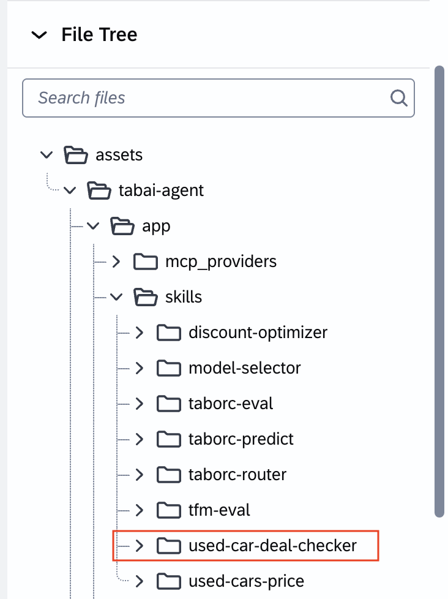

# Exercise 2.2 — Build a Custom Skill

In Exercise 2.1, you ran a base prediction and saw what the service returns. That works, but every user would need to know the right prompt and what columns to fill. A **custom skill** packages your intent into one reusable capability. With this skill, the user can ask *"Is this car a good deal?"* and the skill will handle the prediction and business logic automatically.

A skill is a small folder with a `SKILL.md` file. Joule reads the `description` to decide **when** to use it, and the body to decide **how**. You'll start from the reference skill in this repo and make it your own.

## What is within the `SKILL.md` file
There are two parts:
1. **Frontmatter** (between `---` fences) — two fields:
   - `name`: a kebab-case id.
   - `description`: one line stating *what it does* and *when to use it*. **This is the trigger** — Joule matches the user's request against it, so phrase it with the words a user would say ("estimate price", "how much is this car worth", "predict the gearbox").
2. **Body** — Markdown sections telling the model how to fulfil the request: what inputs it needs,
   which MCP tool to call, and how to present the answer.

## Instructions

### Step 1 — View the reference skill

> Note: This skill orchestrates the pre-provided MCP server. It does not call any API directly and needs no credentials — the MCP handles AI Core auth. You just have to replace the name of the scenario configuration name with `mock-scenario-config`

The completed skill is provided in [`used-car-deal-checker/SKILL.md`](used-car-deal-checker/SKILL.md). Open it and read it top to bottom.

Here are several things to note:
- The **description** lists trigger phrases a marketplace user would actually type.
- The **How it works** section calls the MCP's prediction tool `tabai-mcp` with:
  - The **scenario configuration name** (`mock-scenario-config`),
  - A **model** (`sap-rpt-1.6`),
  - The car's attributes as the query row, with the target column set to `[PREDICT]`.
- On top of the prediction, it takes the seller's asking price and compares it against the predicted market value using a ±5% threshold to give a verdict: **Good deal**, **Fair price**, or **Overpriced**.
- It depends on the base **response-style** guidance so the answer reads cleanly.

Within the SKILL.md file, set the scenario configuration `mock-scenario-config`.

> Tip: don't over-edit. The description's trigger phrases and the single MCP call are what matter.

### Step 3 - Extend the Deployed Agent with a new skill

1. On the panel of Solutions, you should see the `TabAI TechEd Demo` agent in the list. Click on the 3-dots icon and click **Download ZIP**. 
2. Click on down icon on the right of the **New** button.
3. Select **Upload Solution** and choose the downloaded zip file. 
4. You would see a warning message. Click **Copy** to proceed.
5. You should see that this opens up a new agent solution, from your uploaded zip file. 
6. On the right chat panel, you can type:
```
<Paste skill content here>
I want to create a new skill called used-cars-deal-checker. Place it in assets/tabai-agent/app/skills/used-cars-deal-checker.
```
7. Feel free to rename it the file as you wish. 
8. Once the skill has been created, you see that the new skill is added to the specified folder




### Step 4 — Try the new skill

Start a fresh chat via the tabai-agent under **Preview with Mock Data** and use one of the trigger phrases, e.g.:

> "Is 420,000 a fair price for a 2018 Maruti Swift, petrol, manual, driven 45,000 km in Delhi?"

The agent should pick your newly created skill (because the request matches its description), call the MCP prediction tool against **your** scenario configuration, and come back with a verdict — **Good deal**, **Fair price**, or **Overpriced** — along with the predicted market value and the gap.

If Joule picks a different skill or asks which to use, make your skill's `description` more specific to the phrases you want to own, and try again.

## Key Takeaways
- A skill = a `SKILL.md` folder: `description` decides *when*, body decides *how*.
- A custom skill sits **on top of** the base skills and the provided MCP. It doesn't re-implement prediction, it **orchestrates** the MCP tool with your scenario configuration and a sensible model.
- The deal-checker shows the extensibility pattern: the base prediction stays unchanged, and your skill adds business logic (the asking-price comparison) on top of the raw predicted value.
- The same pattern wraps *any* tabular prediction for a business user.
